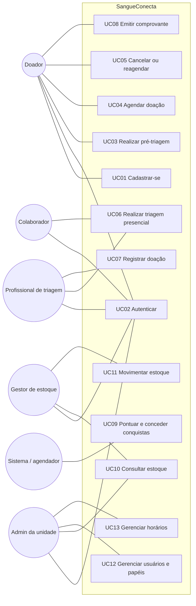

# 04 — Casos de uso

## Visão geral (atores × casos de uso)

| Caso de uso | Doador | Colaborador | Prof. triagem | Admin | Gestor estoque | Sistema |
|---|:-:|:-:|:-:|:-:|:-:|:-:|
| UC01 Cadastro | ● | | | | | |
| UC02 Login | ● | ● | ● | ● | ● | |
| UC03 Pré-triagem | ● | | ○ (consulta) | | | |
| UC04 Agendamento | ● | | | | | |
| UC05 Cancelamento | ● | | | ○ | | ○ (bloqueio) |
| UC06 Triagem presencial | | ○ (check-in) | ● | | | |
| UC07 Registro de doação | | | ● | | | |
| UC08 Documento | ● | | | | | ● |
| UC09 Gamificação | ○ (consulta) | | | | | ● |
| UC10 Consulta de estoque | ○ (nível público) | | | ● | ● | |
| UC11 Alteração de estoque | | | | | ● | |
| UC12 Usuários | | | | ● | | |
| UC13 Horários | | | | ● | | |

● = ator principal · ○ = participação secundária

---

## UC01 — Cadastrar-se

| Campo | Conteúdo |
|---|---|
| **Ator** | Visitante (futuro doador) |
| **Pré-condições** | Não ter conta com o mesmo e-mail. |
| **Fluxo principal** | 1. O visitante abre "Quero doar". 2. Informa nome, e-mail, data de nascimento, telefone (opcional) e senha. 3. Lê e aceita a política de privacidade. Os consentimentos opcionais aparecem desmarcados. 4. O sistema valida os dados (formato, senha forte, idade ≥ 18). 5. O sistema cria o usuário com o papel DOADOR e o perfil de doador, registra os consentimentos com versão e data e publica `UserRegistered`. 6. O sistema envia e-mail de confirmação. 7. O visitante confirma o e-mail pelo link. |
| **Alternativos / exceções** | 4a. E-mail já cadastrado: mensagem genérica ("se o e-mail for válido, você receberá instruções"), para não revelar contas existentes. 4b. Menor de 18: orienta a procurar a unidade (RN18). 4c. Senha fraca: indica os critérios. 7a. Link expirado: permite reenviar. |
| **Pós-condições** | Conta ativa após confirmar o e-mail; consentimentos registrados. |
| **Relacionados** | RF01, RF05, RN18, RNF02, RNF08 |

## UC02 — Autenticar

| Campo | Conteúdo |
|---|---|
| **Ator** | Qualquer usuário cadastrado |
| **Pré-condições** | Conta ativa. |
| **Fluxo principal** | 1. O usuário informa e-mail e senha. 2. O gateway aplica o rate limit. 3. O identity-service verifica o hash. 4. Emite o access token JWT (15 min) com `sub`, `roles` e `unit_ids`, e o refresh token em cookie HttpOnly. 5. O frontend redireciona para a área do perfil. |
| **Alternativos / exceções** | 3a. Credenciais inválidas: 401 com mensagem genérica; o contador de falhas aumenta. 3b. Muitas tentativas: 429 e bloqueio temporário. 3c. Profissional ou admin com MFA ativo (V2): pede o código TOTP. 4a. Token expirado: o frontend chama `/auth/refresh`, que rotaciona o refresh token. Reutilizar um refresh token já usado revoga a família inteira. |
| **Pós-condições** | Sessão ativa; o evento é registrado na auditoria (sem senha). |
| **Relacionados** | RF02, RNF03, RNF06 |

## UC03 — Realizar pré-triagem

| Campo | Conteúdo |
|---|---|
| **Ator** | Doador |
| **Pré-condições** | Autenticado. Existe uma versão publicada do questionário e das regras. |
| **Fluxo principal** | 1. O doador abre a pré-triagem. 2. O sistema mostra o aviso: "Isto não substitui a triagem profissional". 3. O sistema carrega o questionário vigente, que tem perguntas condicionais. 4. O doador responde. 5. O motor de regras avalia as respostas contra o conjunto vigente. 6. O sistema devolve o resultado (PODE_PROSSEGUIR / CONVERSAR_COM_UNIDADE / AGUARDAR com data informativa) e explicações em linguagem simples. 7. O doador escolhe se compartilha as respostas com a unidade (consentimento específico). 8. O sistema grava o resultado com a versão das regras e a data de expiração. Se não houver consentimento para guardar, grava só o resultado. 9. O sistema oferece "Agendar agora". |
| **Alternativos / exceções** | 5a. Nenhuma versão publicada: mensagem "pré-triagem indisponível, procure a unidade"; o agendamento continua liberado. 6a. Resultado CONVERSAR_COM_UNIDADE: mostra o contato da unidade; o agendamento **não é bloqueado** (RN07). 4a. O doador abandona: nada é gravado. |
| **Pós-condições** | Resultado informativo disponível por N dias [HIPÓTESE]. |
| **Relacionados** | RF08, RF09, RF40, RN07, RN08, RNF09, RNF11 |

## UC04 — Agendar doação

| Campo | Conteúdo |
|---|---|
| **Ator** | Doador |
| **Pré-condições** | Autenticado, com e-mail confirmado. |
| **Fluxo principal** | 1. O doador escolhe a unidade. 2. O sistema mostra o calendário com dias disponíveis, conforme grade, bloqueios e ocupação. 3. O doador escolhe dia e horário. 4. O sistema mostra o resumo e as orientações de preparo. 5. O doador confirma; o frontend envia um `Idempotency-Key`. 6. O scheduling-service, numa única transação, verifica RN02 a RN05, incrementa a ocupação do slot de forma atômica (`booked < capacity`) e cria o agendamento BOOKED com o código. 7. Grava o evento `AppointmentBooked` na outbox. 8. Responde 201 com código e detalhes. 9. O notification-service envia a confirmação. |
| **Alternativos / exceções** | 6a. O slot lotou nesse instante: 409 `SLOT_FULL` e o sistema sugere os horários seguintes. 6b. Já existe um agendamento ativo: 409 `ACTIVE_APPOINTMENT_EXISTS`, com link para ele. 6c. Antes da data informativa de elegibilidade: 422 `BEFORE_ELIGIBILITY_DATE`, com explicação. A unidade pode permitir, conforme configuração [VALIDAR-SAÚDE]. 5a. A requisição foi repetida com a mesma chave: devolve o mesmo agendamento, sem duplicar. |
| **Pós-condições** | Vaga reservada; confirmação enviada; lembrete programado. |
| **Relacionados** | RF11, RF12, RF90, RN01 a RN05, RNF15 |

## UC05 — Cancelar ou reagendar

| Campo | Conteúdo |
|---|---|
| **Ator** | Doador (secundários: admin, sistema em caso de bloqueio) |
| **Pré-condições** | Agendamento BOOKED pertencente ao doador. |
| **Fluxo principal (cancelar)** | 1. O doador abre "Meus agendamentos". 2. Escolhe "Cancelar" e, opcionalmente, um motivo categorizado. 3. O sistema confere a janela (RN06). 4. Muda o status para CANCELLED, decrementa a ocupação do slot e publica `AppointmentCancelled`. 5. O doador recebe a confirmação do cancelamento. |
| **Fluxo principal (reagendar)** | 1 a 3 como acima, escolhendo um novo horário. 4. Numa transação: reserva o novo slot, cancela o antigo com o motivo "RESCHEDULED" e cria um novo agendamento ligado ao anterior. 5. Publica `AppointmentRescheduled`. |
| **Alternativos / exceções** | 3a. Fora da janela: 422 `CANCELLATION_WINDOW_CLOSED`, com orientação para contatar a unidade. 4a (reagendar). Novo slot lotado: nada muda (atomicidade). 1a. O admin bloqueia um período: o sistema cancela os agendamentos afetados com o motivo "UNIT_BLOCKED" e notifica os doadores. |
| **Pós-condições** | Vaga liberada; histórico preservado (sem exclusão física). |
| **Relacionados** | RF13, RF14, RF53, RN06 |

## UC06 — Realizar triagem presencial — [SIMULAÇÃO]

| Campo | Conteúdo |
|---|---|
| **Atores** | Colaborador (check-in), Profissional de triagem |
| **Pré-condições** | Agendamento do dia na unidade do profissional, ou atendimento espontâneo registrado. |
| **Fluxo principal** | 1. O colaborador encontra o agendamento pelo código ou nome e faz o check-in; o status vira CHECKED_IN e o evento `AppointmentCheckedIn` é publicado. 2. O profissional vê a fila de check-ins. 3. Abre o atendimento: o clinical-service cria a `screening_session` ligada ao `appointment_id`, depois de confirmar com o scheduling que o agendamento está CHECKED_IN e pertence à unidade do profissional. 4. Se houver consentimento, o profissional vê a pré-triagem; o acesso é auditado. 5. Preenche o formulário mínimo configurado (campos fictícios no protótipo). 6. Define o resultado: APTO ou NÃO APTO. 7. Se NÃO APTO: escolhe se os lembretes de retorno devem ser suspensos (RN17) e, opcionalmente, a data informativa de retorno. 8. Salva; o resultado fica imutável, e correções geram uma nova versão com justificativa. |
| **Alternativos / exceções** | 3a. O scheduling-service está fora do ar: o circuit breaker abre; o profissional pode registrar um atendimento "pendente de vínculo", que é reconciliado depois. 3b. O agendamento pertence a outra unidade: 403. 6a. O usuário não tem o papel PROFISSIONAL_TRIAGEM: 403. |
| **Pós-condições** | Triagem registrada; se APTO, segue para UC07; se NÃO APTO, o atendimento é finalizado (`AttendanceFinished` com `donationCompleted=false`). |
| **Relacionados** | RF32, RF40 a RF42, RF45, RN09, RN17, RNF10, RNF12 |

## UC07 — Registrar doação — [SIMULAÇÃO]

| Campo | Conteúdo |
|---|---|
| **Ator** | Profissional de triagem |
| **Pré-condições** | Triagem com resultado APTO. |
| **Fluxo principal** | 1. O profissional registra o desfecho: CONCLUÍDA, ou NÃO CONCLUÍDA com motivo categorizado e não clínico (ex.: "interrompida", "desistência"). 2. Informa o tipo de coleta (padrão: sangue total) e, opcionalmente, um identificador externo da bolsa [SIMULAÇÃO]. 3. Finaliza o atendimento. 4. O clinical-service grava o `donation_record`, calcula a data informativa de nova elegibilidade pelo conjunto de regras vigente e publica `DonationCompleted` e `AttendanceFinished` pela outbox. 5. Consumidores: o scheduling marca o agendamento COMPLETED e atualiza sua projeção de elegibilidade; o engagement atribui pontos; o notification envia o agradecimento. |
| **Alternativos / exceções** | 4a. A fila está indisponível: o evento fica na outbox e é publicado depois. 5a. O evento chega duplicado: os consumidores ignoram, porque processam de forma idempotente (`processed_events`). |
| **Pós-condições** | Doação no histórico do doador; **o estoque não muda** (RN10). |
| **Relacionados** | RF43, RF44, RF92, RF93, RN10, RN12 |

## UC08 — Emitir comprovante

| Campo | Conteúdo |
|---|---|
| **Ator** | Doador (o sistema gera) |
| **Pré-condições** | Atendimento finalizado pertencente ao doador. |
| **Fluxo principal** | 1. O doador abre o histórico e escolhe "Gerar comprovante". 2. O sistema confere a posse e o status. 3. Gera o PDF a partir de um template versionado com nome, data, unidade, tipo do comprovante (comparecimento ou doação), código de verificação e QR. Inclui o aviso "documento acadêmico" [VALIDAR-JURÍDICO]. 4. Grava o registro do documento com o hash SHA-256 do PDF e o hash do código. 5. Disponibiliza o download autenticado. 6. Opcional: envia o PDF ao e-mail **do próprio doador**. 7. Opcional (Could): o doador gera um link de verificação com validade (ex.: 7 dias) para enviar a terceiros. |
| **Alternativos / exceções** | 2a. Atendimento não finalizado: 409. 3a. Já existe comprovante do mesmo tipo: devolve o existente, sem duplicar. Verificação pública: qualquer pessoa com o código vê apenas "válido / inválido", data, unidade e as iniciais do nome. |
| **Pós-condições** | Documento registrado e verificável. |
| **Relacionados** | RF23, RF24, RN16 |

## UC09 — Pontuar e conceder conquistas

| Campo | Conteúdo |
|---|---|
| **Ator** | Sistema (o engagement-service consome eventos); o doador consulta |
| **Pré-condições** | Eventos `AttendanceFinished` e `DonationCompleted` publicados. |
| **Fluxo principal** | 1. O engagement recebe `AttendanceFinished`. 2. Confere se o evento já foi processado (idempotência). 3. Lança pontos de comparecimento no `points_ledger` (RN12). 4. Se `DonationCompleted`, lança o bônus. 5. Avalia as regras de conquista (RN14): número de comparecimentos e de doações concluídas. 6. Concede conquistas novas e publica `AchievementUnlocked`. 7. O notification parabeniza o doador. 8. O doador vê o painel de progresso. |
| **Alternativos / exceções** | 1a. Engagement fora do ar: as mensagens ficam na fila e são processadas quando ele volta. 3a. Estorno: se o atendimento for anulado, um lançamento negativo de compensação é registrado (o ledger não é editado). |
| **Pós-condições** | Saldo e conquistas atualizados. |
| **Relacionados** | RF20, RF93, RN12 a RN14, RN20 |

## UC10 — Consultar estoque — [SIMULAÇÃO]

| Campo | Conteúdo |
|---|---|
| **Atores** | Admin, Gestor de estoque (o visitante vê só o nível público) |
| **Pré-condições** | Autenticado com o papel adequado e escopo na unidade. |
| **Fluxo principal** | 1. O usuário abre o painel "Painel do Estoque". 2. O sistema mostra o ticker por tipo ABO/Rh: quantidade, variação em relação ao dia anterior, mini-gráfico de 30 dias e status com cor, ícone e texto. 3. O usuário filtra por unidade, período ou hemocomponente. 4. Abre o detalhe de um tipo: série histórica, entradas e saídas, alertas. |
| **Alternativos / exceções** | 2a. Sem dados: estado vazio orientando a cadastrar parâmetros. Visitante: `GET /blood-inventory/public` devolve apenas o nível por tipo. |
| **Relacionados** | RF26, RF60, RF63, RF65, RN11 |

## UC11 — Movimentar estoque — [SIMULAÇÃO]

| Campo | Conteúdo |
|---|---|
| **Ator** | Gestor de estoque |
| **Pré-condições** | Papel GESTOR_ESTOQUE na unidade. |
| **Fluxo principal** | 1. O gestor escolhe "Nova movimentação". 2. Informa o tipo (ENTRADA, SAÍDA, DESCARTE ou AJUSTE), o tipo sanguíneo, o hemocomponente, a quantidade, o motivo e uma referência externa opcional. 3. O inventory-service, numa transação, grava a movimentação, atualiza o saldo com bloqueio de linha e recalcula o status. 4. Se o status mudou, publica `StockLevelChanged`. 5. Registra na auditoria. |
| **Alternativos / exceções** | 3a. A saída deixaria o saldo negativo: 422 `INSUFFICIENT_STOCK`. 2a. AJUSTE sem justificativa: 400. 3b. Edição concorrente: o bloqueio de linha garante a consistência. |
| **Pós-condições** | Saldo e histórico consistentes; alertas disparados. |
| **Relacionados** | RF61, RF62, RF64, RN10, RN11 |

## UC12 — Gerenciar usuários e papéis

| Campo | Conteúdo |
|---|---|
| **Ator** | Admin da unidade (Admin do sistema para papéis globais) |
| **Fluxo principal** | 1. O admin cria a conta de um profissional: nome, e-mail institucional, papéis permitidos para o seu nível e unidades. 2. O sistema envia um convite para definir a senha. 3. O admin pode suspender a conta ou remover papéis; as sessões ativas são revogadas. |
| **Exceções** | O admin da unidade tenta conceder ADMIN_SISTEMA: 403. Não é permitido remover o último admin de uma unidade. |
| **Regras** | Menor privilégio; toda mudança de papel vai para a auditoria. |
| **Relacionados** | RF55, RNF04, RNF12 |

## UC13 — Gerenciar horários

| Campo | Conteúdo |
|---|---|
| **Ator** | Admin da unidade |
| **Fluxo principal** | 1. O admin define a grade semanal: dias (ex.: quinta, sexta e sábado), início e fim, duração do slot, capacidade por slot e capacidade diária. 2. O sistema gera (materializa) os slots das próximas N semanas. 3. O admin cadastra bloqueios (data e horário, motivo) e campanhas (período, capacidade extra, código). |
| **Exceções** | 1a. A nova grade conflita com slots que já têm agendamentos: o sistema mantém esses slots e avisa. 3a. Um bloqueio afeta agendamentos existentes: lista os afetados e pede confirmação; ao confirmar, cancela com notificação (UC05-1a). |
| **Relacionados** | RF51 a RF54, RN01, RN02 |
