# 05 — Fluxos

> Diagramas em **Mermaid**, que o GitHub renderiza automaticamente. Para os slides, exporte em [mermaid.live](https://mermaid.live).

## 1. Fluxo do doador

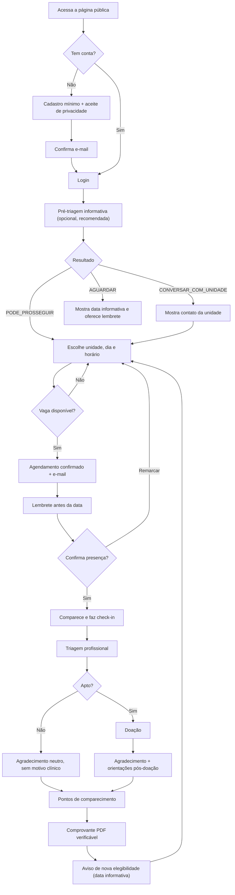

## 2. Fluxo do profissional (colaborador + profissional de triagem)

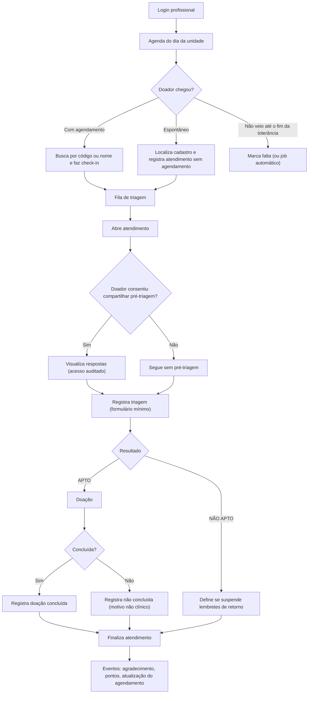

> No protótipo, J, K, L e M são [SIMULAÇÃO]. Em produção, esses passos aconteceriam no sistema oficial da instituição, e só o desfecho seria sincronizado (ver [documento 14](14-riscos-diferenciais-recomendacoes.md)).

## 3. Fluxo do administrador

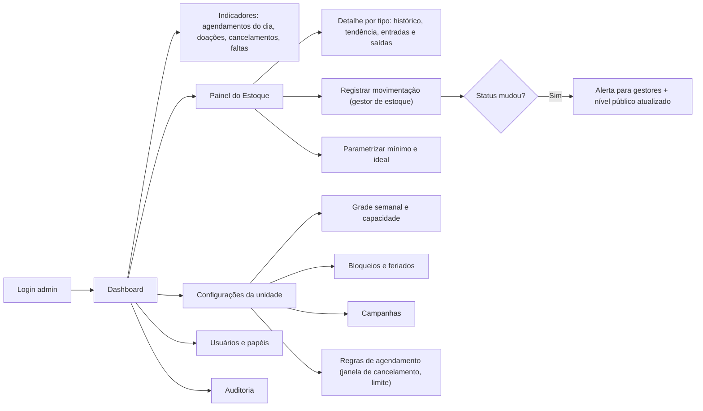

## 4. Fluxo de agendamento

### 4.1 Sequência

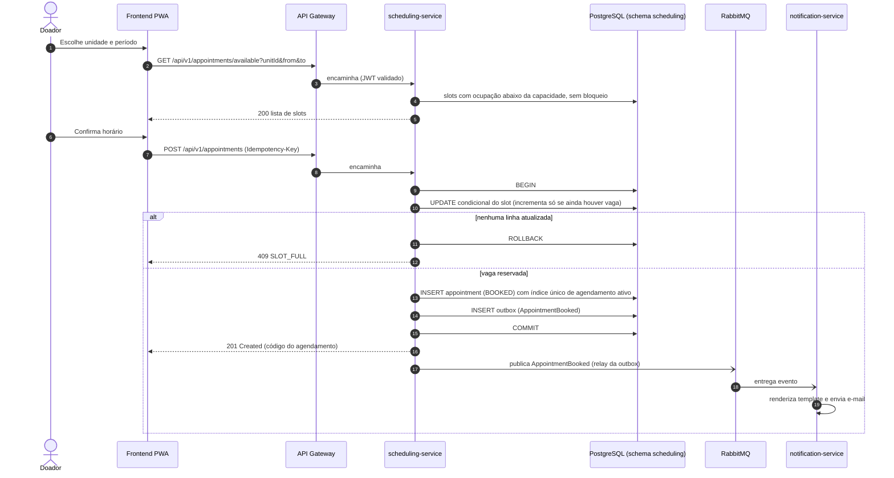

### 4.2 Estados do agendamento

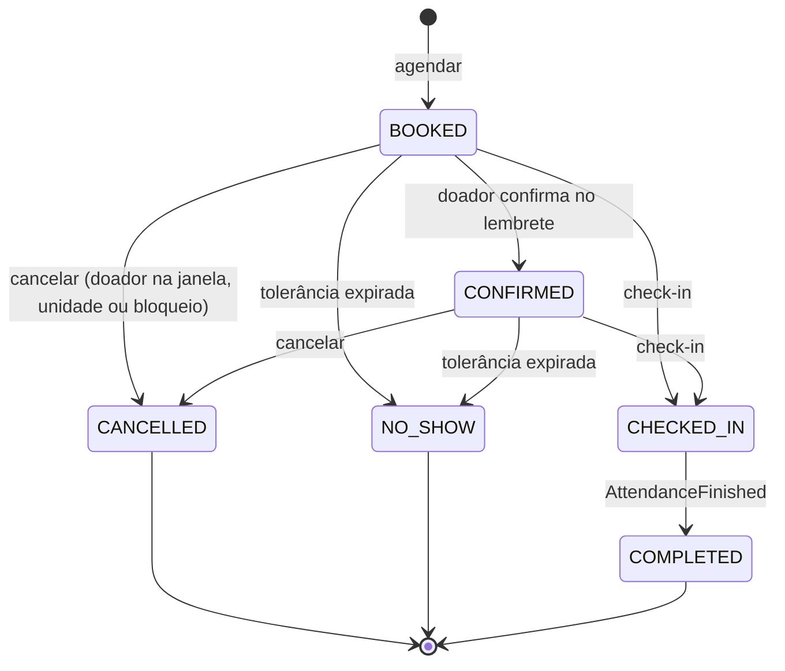

> "Ativo" (RN03) = BOOKED, CONFIRMED ou CHECKED_IN.

## 5. Fluxo de triagem

### 5.1 Pré-triagem (motor de regras configurável)

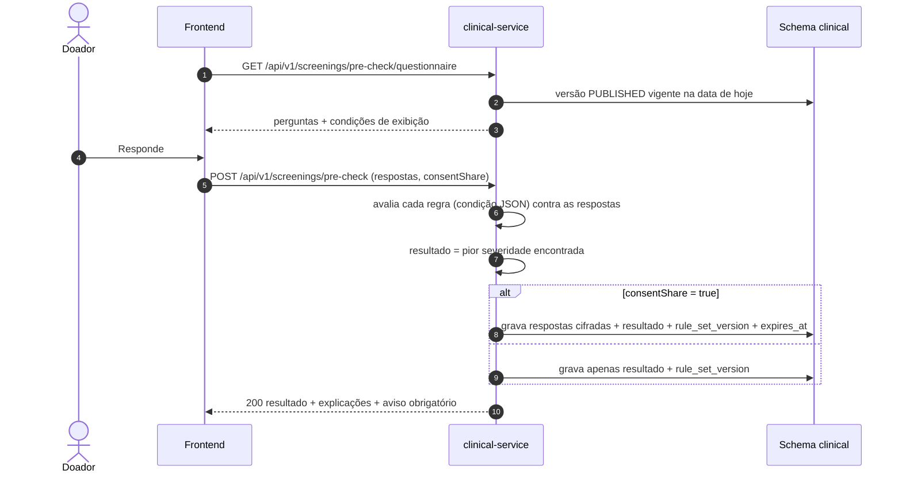

**Como uma regra é representada (exemplo ilustrativo, não é regra clínica):**

```json
{
  "code": "PESO_MINIMO",
  "questionCode": "PESO_KG",
  "condition": { "op": "lt", "value": 50 },
  "severity": "CONVERSAR_COM_UNIDADE",
  "messageKey": "pre_check.weight.below_min",
  "normativeReference": "Portaria de Consolidação GM/MS nº 5/2017, Anexo IV-B (conferir artigo)",
  "status": "PENDENTE_VALIDACAO"
}
```

> Os valores e a referência acima são **exemplo de formato** [VALIDAR-SAÚDE]. Nenhuma regra é publicada sem aprovação registrada (RN08).

### 5.2 Triagem presencial — [SIMULAÇÃO]

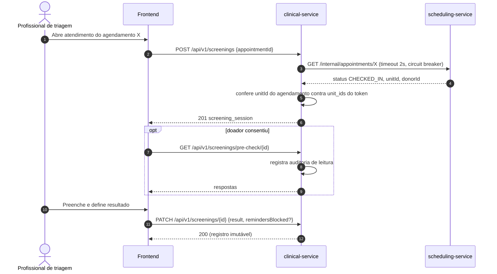

## 6. Fluxo de doação

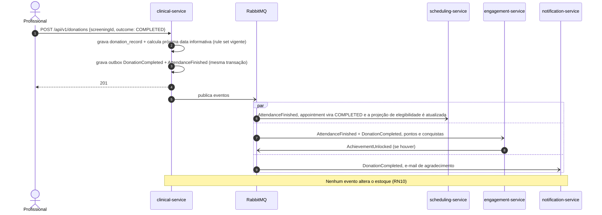

## 7. Fluxo de atualização do estoque — [SIMULAÇÃO]

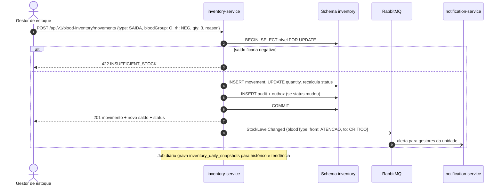

## 8. Fluxo de emissão de documento

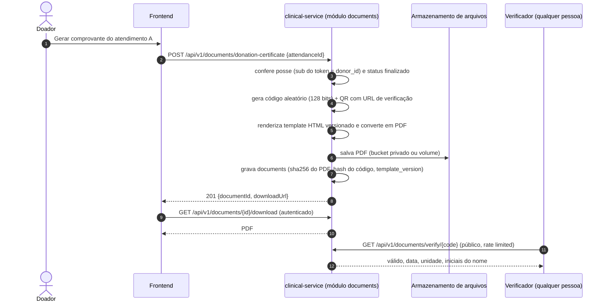

## 9. Fluxo de notificações

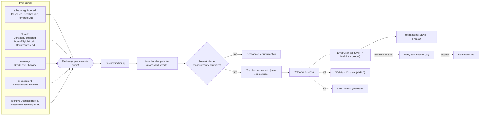

**Trocar de fornecedor sem alterar o resto do sistema:** o notification-service define a interface `NotificationChannel` (porta) e cada fornecedor é um adaptador (`SmtpEmailChannel`, `SesEmailChannel`, `TwilioSmsChannel`…), escolhido por configuração. Os outros serviços só publicam **eventos de domínio**. Eles não sabem que existe e-mail ou SMS.
