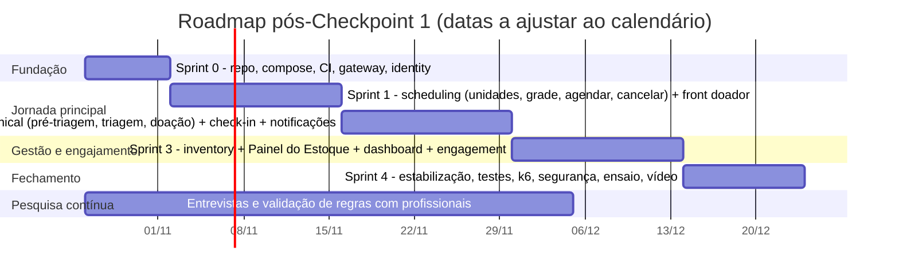

# 13 — MVP e roadmap

## PARTE 15 — MVP

### 15.1 Critério de corte

O MVP precisa **demonstrar a jornada completa de ponta a ponta com o menor número de funcionalidades**, provar a arquitetura (gateway, serviços, eventos, segurança) e caber no tempo de uma equipe de estudantes. Tudo que é "bonito, mas não essencial para a história" fica para depois.

**A história que o MVP precisa contar na apresentação final:**
> Ana se cadastra → faz a pré-triagem → agenda para quinta às 9h → recebe o e-mail → no dia, Marcos faz o check-in → Juliana registra a triagem e a doação (simuladas) → Ana recebe o agradecimento e a conquista "Primeiro Passo" → Paula vê o dashboard e o "Painel do Estoque" com O- crítico, registra uma movimentação e vê o alerta.

### 15.2 Escopo

| Área | **MVP (Must)** | **MVP estendido (Should, se houver tempo)** |
|---|---|---|
| Identidade | Cadastro (RF01), login, refresh, logout (RF02), editar perfil (RF04), consentimentos (RF05), criação de profissionais e papéis (RF55) | Recuperação de senha (RF03), exclusão de conta (RF06) |
| Conteúdo | Página pública estática com conteúdo educativo e fontes (RF07) | — |
| Pré-triagem | Questionário e regras de **exemplo** carregados por migração, motor de regras, resultado com aviso (RF08, RF09) | Visualização pelo profissional com consentimento (RF40); data informativa (RF25) |
| Agendamento | Unidades (RF50), grade semanal (RF51), bloqueios (RF53), vagas (RF10, RF11), agendar (RF12), cancelar (RF13), meus agendamentos (RF15) | Reagendar (RF14), confirmar presença (RF16), falta automática (RF95) |
| Atendimento [SIMULAÇÃO] | Agenda do dia (RF30), busca (RF31), check-in (RF32), falta manual (RF34), triagem com resultado (RF41, RF42), registro da doação (RF43, RF44) | Espontâneo (RF33), observações restritas (RF45) |
| Pós-doação | Histórico (RF17), e-mail de confirmação, lembrete e agradecimento (RF90, RF91, RF92) | Comprovante PDF verificável (RF23) |
| Gamificação | Pontos de comparecimento e bônus de doação + 3 conquistas (RF20, RF93) | — |
| Estoque [SIMULAÇÃO] | Níveis com status (RF60), movimentações (RF61), parâmetros (RF62), painel "bolsa de valores" (RF65), seed com 30 dias de histórico fictício | Histórico detalhado (RF63), alertas por e-mail (RF64, RF97), snapshots (RF96) |
| Dashboard | Indicadores do dia e do período compostos pelos serviços (RF56) | — |
| Arquitetura | Gateway + 6 serviços (ou o plano B), PostgreSQL com schema por serviço, RabbitMQ, outbox + idempotência, JWT + RBAC + escopo, OpenAPI por serviço, Docker Compose, CI com build e testes | Correlation ID visível nos logs, teste de carga k6 |

### 15.3 Ordem de corte (se atrasar)

Cortar **de baixo para cima**, sem nunca cortar a jornada principal:

1. Comprovante PDF → mostrar o mockup no Figma.
2. Visualização da pré-triagem pelo profissional.
3. Lembrete automático → manter só a confirmação.
4. Alertas de estoque por e-mail → manter o status no painel.
5. Último recurso: aplicar o plano B da arquitetura (fundir engagement e notification).

### 15.4 Versão 2

| Funcionalidade | Por que esperar |
|---|---|
| Reagendamento, lista de espera, confirmação ativa com liberação de vaga | Importantes para reduzir faltas, mas dependem do fluxo básico estável |
| Comprovante verificável + link de compartilhamento com expiração | Precisa de validação jurídica e da instituição |
| Horas complementares com aprovação institucional | Depende de convênio |
| Interface de gestão de regras de pré-triagem com aprovação (RF70, RF71) | No MVP, migração e seed bastam |
| Web push (PWA) e preferências completas | Esforço extra de configuração (VAPID, service worker) |
| Reporting-service (CQRS) e `GET /dashboard/statistics` agregado | Só se justifica com volume e mais indicadores |
| MFA (TOTP) para profissionais e admin | Segurança adicional |
| Nível público do estoque por tipo + "seu tipo está crítico" (com consentimento) | Exige política de comunicação da instituição |
| Exportação de dados (LGPD) self-service | Direito do titular automatizado |
| Campanhas com código (turmas e empresas) e **metas coletivas** | Ótimo para universidades; depende do fluxo básico |
| Observabilidade completa (OpenTelemetry, Prometheus, Grafana) | Valor didático alto, mas não essencial |
| Modo escuro, Atkinson Hyperlegible como opção | Refinamento de acessibilidade |

### 15.5 Futuro

- Integração com o sistema oficial da instituição (sincronizar comparecimento e desfecho, evitando dupla digitação), possivelmente via padrões de interoperabilidade em saúde (ex.: HL7 FHIR) **se** a instituição adotar.
- Login gov.br para cidadãos; assinatura digital (ICP-Brasil) de documentos emitidos pela instituição.
- Previsão de faltas e *overbooking* inteligente (inspirado em Bosnes et al., 2005).
- Previsão de estoque crítico (séries temporais) e convocação direcionada com consentimento.
- SMS e WhatsApp (custo e contratos).
- Apps nativos, se a pesquisa mostrar demanda.
- Multi-instituição (vários hemocentros) e integração com bases públicas.
- Mensagem pós-doação com "para onde foi sua doação", que depende de integração (efeito observado por Gemelli et al., 2018).

### 15.6 Definition of Done (por funcionalidade)

- [ ] Critérios de aceite do RF atendidos e demonstráveis.
- [ ] Endpoint documentado no OpenAPI, com exemplos.
- [ ] Autorização testada (caso positivo + caso de acesso negado).
- [ ] Testes unitários das regras de domínio; integração com Testcontainers nos fluxos críticos.
- [ ] Sem dado pessoal ou de saúde nos logs.
- [ ] Tela responsiva e navegável por teclado, com contraste conferido.
- [ ] PR revisado por outra pessoa; CI verde.

---

## PARTE 16 — Roadmap

> Hoje é **16/10/2026**. O Checkpoint 1 é **de 19/10 a 23/10/2026**. As datas depois do CP1 são [HIPÓTESE] e devem ser ajustadas ao calendário oficial da disciplina.

### 16.1 Até o Checkpoint 1 (16/10 → 23/10): **nenhuma linha de código de produto**

| Quando | Entregável | Responsável sugerido |
|---|---|---|
| 16–17/10 | Ler e revisar esta documentação; decidir o nome (checagem no INPI) e o plano de arquitetura (6 ou 4 serviços) | Todos |
| 17–18/10 | Enviar e-mails de contato para 2 ou 3 hemocentros ou hospitais e para a coordenação do curso | Pesquisa |
| 17–19/10 | Wireframes no Figma das 10 telas-chave ([12-identidade-visual](12-identidade-visual.md), item 14.8); alta fidelidade de 3 delas (pré-triagem, horário, Painel do Estoque) | UX/Front |
| 18–19/10 | Exportar os diagramas Mermaid (arquitetura, ER, 2 sequências) para os slides | Arquitetura |
| 18–20/10 | Planilha de fichamento com as 10 primeiras fontes lidas | Pesquisa |
| 19–20/10 | Deck do Checkpoint 1 ([15-checkpoint-1](15-checkpoint-1.md)) e ensaio cronometrado | Todos |
| 19–23/10 | **Apresentação do Checkpoint 1** | Todos |

### 16.2 Após o Checkpoint 1

| Marco | Conteúdo | Critério de sucesso |
|---|---|---|
| **Sprint 0** | Monorepo, Docker Compose (Postgres, RabbitMQ, Mailpit), gateway, identity com JWT/JWKS, frontend base com login, CI | `docker compose up` sobe tudo; login funcionando de ponta a ponta |
| **Sprint 1** | scheduling completo do MVP + telas do doador | Agendar e cancelar com prova de não sobrealocação |
| **Sprint 2** | clinical (pré-triagem com regras seed, triagem e doação simuladas) + check-in + notification (e-mails) | Jornada do doador completa até o agradecimento |
| **Checkpoint intermediário** (se houver) | Demo da jornada principal | — |
| **Sprint 3** | inventory + painel + dashboard + engagement (pontos e conquistas) | História completa da 15.1 demonstrável |
| **Sprint 4** | Itens Should que couberem, testes, teste de carga, revisão de segurança, backup e restauração testados, vídeo de contingência | Ensaio sem falhas 2 vezes seguidas |
| **Apresentação final** | Demo ao vivo + vídeo de backup + relatório | — |

> **Oportunidade de calendário:** 25/11 é o Dia Nacional do Doador de Sangue. Se coincidir com a fase final, dá para fazer uma ação de divulgação na faculdade usando o protótipo (com dados fictícios) e conteúdo educativo.

### 16.3 Divisão sugerida (equipe de 5)

| Pessoa | Responsabilidade principal | Secundária |
|---|---|---|
| 1 | Arquitetura, gateway, identity-service, CI/CD | Segurança (revisão) |
| 2 | scheduling-service | Teste de carga |
| 3 | clinical-service (regras, triagem, documentos) | LGPD e RIPD |
| 4 | inventory-service + engagement + notification | Dados fictícios (seed) |
| 5 | Frontend, UX, identidade visual | Acessibilidade |
| Todos | Pesquisa bibliográfica e de campo, documentação | — |
